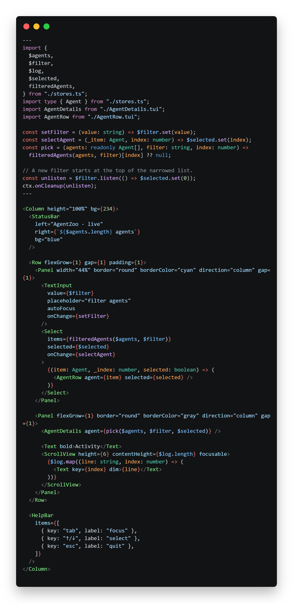

# AgentZoo Walkthrough

AgentZoo is the end-to-end example: a filtered agent roster, details panel,
progress, live activity log and focus.



## Run

```sh
deno task build:examples
deno run -RE=NODE_ENV examples/agent-zoo/main.ts
```

Or from the repo root:

```sh
deno task example:zoo
```

`example:zoo` builds, type-checks, then runs. For an unattended smoke run:

```sh
deno run -RE=NODE_ENV examples/agent-zoo/main.ts --demo-ms=1500
```

Compiled binary:

```sh
deno task build:examples
deno compile --allow-read --allow-env=NODE_ENV \
  --output local/agent-zoo.exe examples/agent-zoo/main.ts
```

## Files

| File               | Role                                                      |
| ------------------ | --------------------------------------------------------- |
| `stores.ts`        | Agents, filter, selection, log, activity tick             |
| `AgentZoo.tui`     | Shell: status bar, filter, roster, details, log, help bar |
| `AgentRow.tui`     | One roster row (status glyph, name, role)                 |
| `AgentDetails.tui` | Selected agent, progress, empty state                     |
| `main.ts`          | `createApp`, key bindings, simulation interval            |

## Patterns

### Function children + typed callbacks

```tui
<Select
  items={filteredAgents($agents, $filter)}
  selected={$selected}
  onChange={selectAgent}
>
  {(item: Agent, _index: number, selected: boolean) => (
    <AgentRow agent={item} selected={selected} />
  )}
</Select>
```

`Select` owns focus/arrow handling; the function child renders a row. The
parameters are typed because generated modules are type-checked.

### Frontmatter snapshots vs live props

`AgentRow`/`AgentDetails` receive an agent object that changes every tick. They
read it through an accessor:

```ts
const agent = () => props.agent as Agent;
```

```tui
<Text>{agent().name}</Text>
```

A plain `const agent = props.agent` would freeze the first value, because
frontmatter runs once.

### Filter reset

```ts
const unlisten = $filter.listen(() => $selected.set(0));
ctx.onCleanup(unlisten);
```

A new filter starts at the top of the narrowed list. `listen` does not fire
immediately; cleanup unsubscribes on unmount.

### Arrows while typing

`TextInput` consumes printable keys but not Up/Down. `main.ts` handles those at
the app level:

```ts
if (!event.defaultPrevented && event.name === "down") {
  moveSelection(1);
  event.preventDefault();
}
```

When `Select`/`ScrollView` is focused, it consumes arrows and sets
`defaultPrevented`, so the app handler does not move twice.

### Scrolling activity

```tui
<ScrollView height={6} contentHeight={$log.length} focusable>
  {$log.map((line: string, index: number) => (
    <Text key={index} dim>{line}</Text>
  ))}
</ScrollView>
```

Tab to the log and use arrows/Page/Home/End. `contentHeight` enables clamping.

## Keys

| Key             | Action                                                                                    |
| --------------- | ----------------------------------------------------------------------------------------- |
| type            | filter the roster (when the input is focused)                                             |
| Tab / Shift-Tab | cycle filter → roster → log                                                               |
| Up/Down         | move the selection (works with the filter focused; prevented when a component handles it) |
| Enter           | select in the roster (when focused)                                                       |
| Esc / Ctrl-C    | quit and restore the terminal                                                             |

## What to inspect

- Store updates coalesce into one frame; progress and log update live.
- The surface background is inherited by text/border cells (no holes).
- Borders are painted after clipped/scrolled children.
- Resize the window while running: the frame is cleared/repainted atomically and
  the cursor is parked, so content does not roll.
